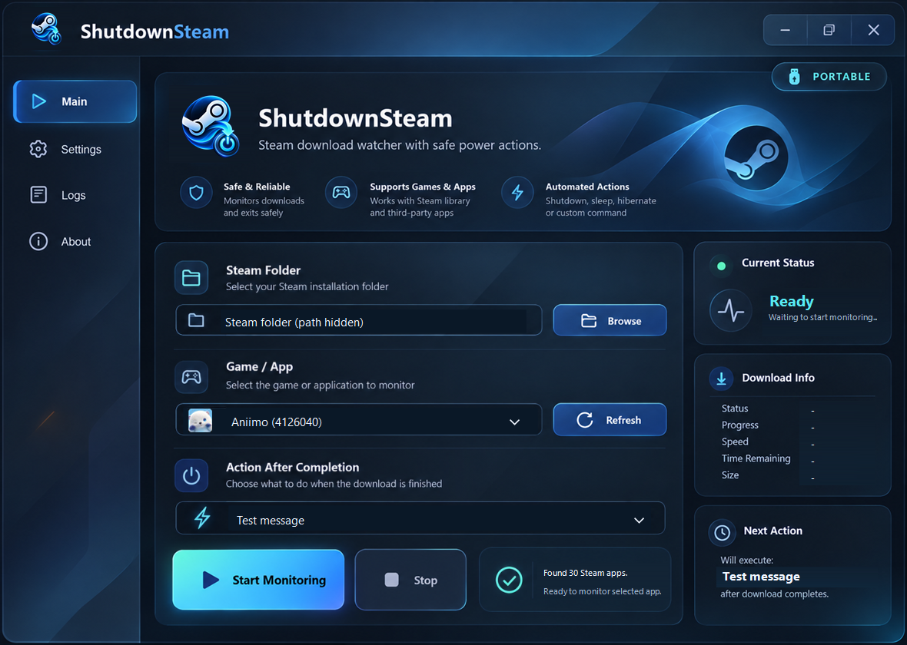

# ShutdownSteam


A lightweight portable Windows app that runs an action after a selected Steam game finishes downloading.

Created by [MhDTam](https://github.com/MhDTam). Source code is licensed under MIT.

## Screenshot



Actual application screenshot with a real Steam game and its locally cached icon. The machine-specific folder path is hidden.

## Download and Run

Download `ShutdownSteam-<version>-Windows-Portable.zip` from this repository's **Releases** page, extract it, and run `ShutdownSteam.exe`. The EXE works on its own; no installer is required.

**Requirements:** Windows 10/11 with .NET Framework 4.x. The app is unsigned.

## Features

- Glass dashboard with Main, Settings, Logs, and About views.
- Steam library discovery, including additional library folders.
- Game thumbnails from Steam's local cache in both the selection field and dropdown.
- Test notification, shutdown, restart, hibernate, and lock actions.
- Adjustable polling interval and session logs.
- Single executable with embedded artwork; no network requests or telemetry.

## Use

1. Choose the Steam installation folder if it was not detected.
2. Select the game and the action to run when its download finishes.
3. Press **Start Monitoring**. Keep Steam and ShutdownSteam running.
4. Press **Stop** to stop monitoring.

The app waits until it sees the selected game incomplete and then complete. Choosing an already-installed game does not trigger an immediate action. The target and action cannot change while monitoring is active.

**Try it safely:** Settings > Test notification displays a harmless message immediately. Choosing Test message in the action dropdown displays that message after a download completes.

Shutdown and restart use a 60-second Windows countdown. Settings > Cancel scheduled shutdown requests cancellation. You can also run:

```powershell
shutdown.exe /a
```

Stopping monitoring does not cancel a shutdown already scheduled with Windows.

## Game Pictures

Artwork is read from `appcache/librarycache` inside the selected Steam installation. Both legacy `<appid>_...` filenames and newer per-app folders are supported. Square game icons are preferred, with cached banners or capsules used as fallbacks. Missing or corrupt pictures show a gamepad icon.

Images are cached as small thumbnails in memory and do not lock Steam's files. Press Refresh after Steam adds new artwork. No game artwork is bundled with releases.

## Build and Test

Use Windows PowerShell 5.1. The scripts use the C# compiler shipped with .NET Framework; a .NET SDK and NuGet packages are not required.

```powershell
.\build.ps1
.\test.ps1
.\package.ps1 -Version 1.0.0
```

Output:

- `portable/ShutdownSteam.exe`: standalone executable.
- `release/ShutdownSteam-1.0.0-Windows-Portable.zip`: distribution archive.
- `release/SHA256SUMS.txt`: SHA-256 hashes for the ZIP and EXE.

Build scripts regenerate the embedded icon from `assets/Emblem-Public.png`. The sanitized `assets/Dashboard.png` screenshot doubles as the embedded visual skin, with working controls and live values drawn over its example content.

Generate UI previews and verify Start/Stop control states without executing a power action:

```powershell
.\portable\ShutdownSteam.exe --preview .\verification
```

An optional third argument selects a Steam root for the preview. Preview files can contain local library names and paths; they are ignored by Git.

For a shareable screenshot that does not read a local Steam library, use:

```powershell
.\portable\ShutdownSteam.exe --public-preview .\verification\public
```

## Automation and Publishing

GitHub Actions builds, tests, and uploads portable artifacts on main-branch pushes and pull requests. Pushing a version tag such as `v1.0.0` also publishes a GitHub Release with the ZIP, EXE, and checksums.

See [publishing instructions](docs/PUBLISHING.md), [changelog](CHANGELOG.md), and [contributing guide](CONTRIBUTING.md).

## Limitations

- Completion is inferred from Steam manifest state and the app's downloading folder. Pause, verification, and unpacking can delay the transition.
- Progress and size are shown only when Steam provides usable manifest byte counts. Speed and remaining time are shown as `-`.
- Hibernate requires hibernation support in Windows.
- Session settings/logs are held in memory and reset when the application closes.
- The design artwork includes descriptive mockup copy. The supported actions are exactly those listed in this README; custom commands and non-Steam download clients are not supported.

## License and Branding

Copyright (c) 2026 MhDTam. Source code, build scripts, and original documentation use the [MIT license](LICENSE), which requires preservation of the copyright and license notice. Supplied artwork and third-party marks are excluded. See [artwork and branding notices](THIRD_PARTY_NOTICES.md).

This independent project is not affiliated with or endorsed by Valve Corporation.
